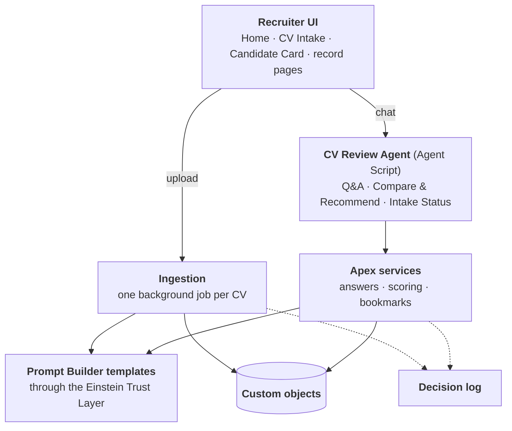
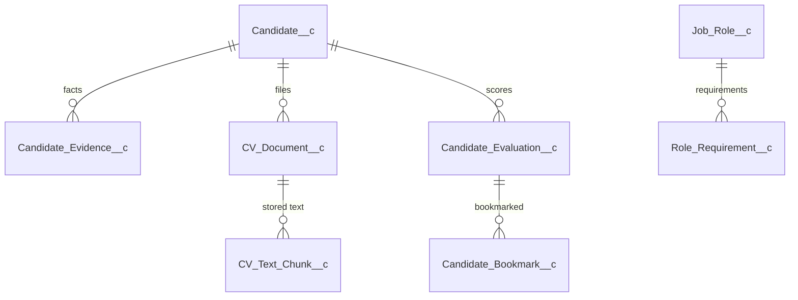

# CV Review Agent on Salesforce

An Agentforce employee agent that helps recruiters review CVs:

- It reads uploaded PDF and DOCX CVs into evidence-backed **Candidate Cards**.
- It answers questions only from the CV text, with sources.
- It ranks candidates against a role with a score that can be checked requirement by requirement.
- It saves chosen candidates as bookmark records with the recruiter's notes.

**Source code:** [github.com/mostafaelamory/cv-review-agent](https://github.com/mostafaelamory/cv-review-agent)

> **The one idea behind the design:** every fact taken from a CV is stored as its own record, with a status, a confidence and the exact quote it came from. The model reads and judges. Apex checks every quote and every citation, and does all the scoring. The model never writes records.

---

## Walkthrough

1. **Upload.** The recruiter drops CVs (PDF or DOCX) on the CV Intake tab or on a Job Role page, several files at once (up to 10 per batch by default, 25 at most). Each file is processed in its own background job, with its own status, so one bad file doesn't stop the others:
   - DOCX text is read in Apex, by unzipping the file.
   - PDF text is read in the browser from the file's text layer.
   - Legacy `.doc` files are rejected with a clear message.
2. **Candidate Card.** A prompt template turns the CV text into facts, each with a verbatim quote. Apex then:
   - verifies every quote against the stored text;
   - computes total experience from the role dates;
   - flags gaps and contradictions;
   - flags possible duplicate candidates.

   The card shows each fact with a badge: Stated, Inferred, Missing, Conflicting or Unverified.
3. **Ask.** In the Agentforce panel the recruiter asks, for example, *"Does Omar have Apex experience?"* or *"Who has worked with MuleSoft?"*. The answer cites its sources, and Apex rejects any citation it did not retrieve. If the CVs don't support an answer, the agent replies *"Not stated in the CV."*
4. **Rank.** *"Rank Lina, Omar and Youssef for Senior Salesforce Developer."*
   - The model labels each requirement Met, Partial, Not evidenced or Contradicted, without seeing names or contact details.
   - Apex computes the score and band.
   - The agent recommends, explains the trade-offs and suggests interview questions. When no one is a strong match, it names the best available candidate and the gaps.
   - *"Why is Lina above Omar?"* returns the requirements where their points differ.
5. **Bookmark.** After scoring, the agent offers to bookmark a candidate. On confirmation it saves one record with the overview, score, reasoning, role and the recruiter's notes. The record cannot be changed afterwards.
6. **Audit.** Every step writes a decision log entry: inputs, evidence used, prompt version, grounding check, outcome and latency. An Agent Health report sits on top of the log.

**Bonus items:** scoring explainability is steps 4 and 5; the audit of agent decisions is step 6.

---

## Architecture overview



- **UI:** Lightning Web Components for the home page, upload, Candidate Card and score breakdown. The ranking table in the agent panel is a component, so the model cannot reword it.
- **Agent:** an Agentforce employee agent written in Agent Script, with three subagents. It runs as the logged-in recruiter, so it only sees what that recruiter can see.
- **Apex:** all data access in user mode, all scoring and all checks. The model is called through an interface, so tests use a stub.
- **AI:** five Prompt Builder templates (extract, answer, assess, recommend, transcribe). Every call goes through the Einstein Trust Layer.

---

## Data model and Candidate Card design



| Object | Purpose |
|---|---|
| Candidate | Card header: name, contact, headline, total experience, completeness, conflict and duplicate flags |
| Candidate Evidence | **One fact per record:** category, value, dates, status, confidence, verified quote, page |
| CV Document / CV Text Chunk | The uploaded file, its processing status, and its stored text |
| Job Role / Role Requirement | The role and its weighted must-have and nice-to-have requirements |
| Candidate Evaluation | One scoring run, with a per-requirement breakdown |
| Candidate Bookmark | The recruiter's saved decision: a snapshot plus notes |
| Agent Decision Log | The audit trail |

**How the card shows uncertainty**

| Status | Meaning |
|---|---|
| Stated | Written in the CV; the quote was found in the text |
| Inferred | Derived (e.g. total experience from dates); always carries a reason |
| Missing | Expected but not found (e.g. no education); stored as a record, so gaps are visible |
| Conflicting | The CV disagrees with itself (e.g. "10 years" against about 6 years of dated roles); both versions are kept |
| Unverified | The quote was not found in the text; low confidence, excluded from scoring |

**Confidence comes from rules, not from the model:**

- High: Stated with a verified quote.
- Medium: Inferred, or dates given as a year only.
- Low: Conflicting or unverified.

---

## Key design decisions and trade-offs

| Decision | Why | Trade-off |
|---|---|---|
| One record per fact, not one blob per candidate | Each fact gets its own status, source and filters | More records |
| Apex computes the score; the model only labels requirements | Reproducible, explainable, testable | Labels are coarse (four values) |
| Answers are written by a template inside an Apex action and checked before return | Citations are verified in code and logged | One extra model call per question |
| Confidence from rules | Model confidence is not reliable | Only three levels |
| Keyword search (SOQL and SOSL) instead of vector search | No extra Data Cloud setup for a prototype | No semantic search |
| Bookmark as an immutable snapshot | Stays true if the CV or role changes later | Duplicated data |
| PDF text read in the browser | Sending the PDF file to a prompt template did not work in the target org | Scanned PDFs depend on a model fallback |

---

## Assumptions

- Synthetic CVs only. Real candidate data would need consent and retention rules.
- CVs are PDF or DOCX, mostly English, and a few pages long.
- One persona: the recruiter. An admin maintains roles and weights.
- A Developer Edition org with Agentforce: about 150 model calls per hour and one Agentforce user license.

## Known limitations

- Uploads are batches of up to 25 files. There is no ZIP or email intake for large volumes.
- Legacy `.doc` files are rejected, not converted.
- Scanned PDFs without a text layer fail with a clear reason if the model fallback cannot read them.
- Search is keyword-based, not semantic.
- Duplicates are detected by exact email only, and are flagged, not merged.
- Model wording can vary between runs. Scores stay stable because Apex computes them and caches the results.
- Scores are relative to the role's requirements, not an absolute rating of a candidate.

---

## Testing approach

| Layer | Approach | Result |
|---|---|---|
| Apex unit tests | A stub model returns valid, broken and tricky responses. Tests run as a recruiter user with only the recruiter permission set. | 41 of 41 pass, 91% coverage |
| Component tests (Jest) | Upload, card badges and corrections, score breakdown, ranking card, home page | 26 of 26 pass |
| Sample CV set | Ten synthetic CVs, each covering one edge case (missing education, overlapping dates, contradictions, two-column layout, scan, legacy `.doc`, duplicate), checked against expected results | Names and emails 16/16, skills 41/41, quotes verified 136/136, gaps and conflicts all found |
| Agent conversations | Scripted multi-turn chats against the live agent: cited answers, "not stated", ambiguous names, ranking, explanations, bookmark with confirmation | All behave as designed |

---

## Setup

```bash
sf org login web --alias cv-agent
sf project deploy start --manifest manifest/package.xml --target-org cv-agent
sf org assign permset --name CV_Recruiter --name CV_Agent_Admin --name EinsteinGPTPromptTemplateUser --target-org cv-agent
sf apex run --file scripts/apex/seed_job_role.apex --target-org cv-agent
sf agent publish authoring-bundle --api-name CV_Review_Agent --target-org cv-agent --json
sf agent activate --api-name CV_Review_Agent --target-org cv-agent --json
```

Then, in Agentforce Builder, add the Lightning Experience connection to the agent. Open the **CV Review** app and upload the sample CVs from `data/golden-cvs/files/`.
